  

  
  
  
  

  <picture>
    <source media="(prefers-color-scheme: dark)" srcset="assets/snake-dark.svg">
    
  </picture>

## About

I'm a 3rd-year student at **Muğla Sıtkı Koçman University** who likes the part of software nobody sees: the backend.

I learn by building. Each new topic becomes a project that runs against a real Docker Compose stack, and the bugs I hit on the way (N+1 queries, consumer-group mistakes, cache invalidation) stay in the commit history instead of being hidden.

- 🔭 Building event-driven APIs with **Spring Boot** and **Go**
- 🌱 Growing from backend toward **DevOps**: containers, CI/CD and the infrastructure that keeps services running
- 🎯 Looking for a backend **internship**
- 📫 Reach me at [gucyusuff@gmail.com](mailto:gucyusuff@gmail.com) or on [LinkedIn](https://www.linkedin.com/in/yusufguc/)

## Tech I work with

  

## Featured projects

| Project | What it is | Stack |
| --- | --- | --- |
| [**ecommerce-backend**](https://github.com/yusufguc/ecommerce-backend) | Event-driven e-commerce API. Orders flow through Kafka after the DB transaction commits, product listings are cached in Redis, auth is JWT with refresh-token rotation and rate limiting. | Java 21 · Spring Boot 4 · Kafka · Redis · PostgreSQL · Docker |
| [**SpringFoodOrderingApi**](https://github.com/yusufguc/SpringFoodOrderingApi) | Food ordering API with multi-role access, Flyway migrations and Swagger docs. | Spring Boot 3 · Spring Security · JWT · PostgreSQL |
| [**MovieReservationSystem**](https://github.com/yusufguc/MovieReservationSystem) | Backend for booking movie seats. | Spring Boot · PostgreSQL |

### In the workshop

Not public yet, still being polished:

- **bankflow-api** — fintech backend: distributed transactions, idempotency, fraud detection, multi-currency accounts (Spring Boot)
- **gymflow-api** — gym management with Redis locks, Kafka events and QR check-in (Go)
- **chat-api** — real-time WebSocket chat (Go)

  

